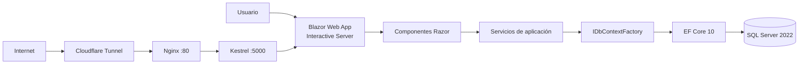

# InstitutoBlazor

[](https://github.com/LautaroDabrowski/NotaDeRoble/actions/workflows/ci-deploy.yml)

Migración del CRUD original en **PHP/MySQL** a una aplicación **C# + Blazor Web App + Entity Framework Core + SQL Server**, preparada para ejecutarse y desplegarse en **Ubuntu Server**. Proyecto integrador de **EDIWEB**.

**Demo:** [plugins-necessary-forms-tba.trycloudflare.com](https://plugins-necessary-forms-tba.trycloudflare.com)  
**Repositorio:** [LautaroDabrowski/NotaDeRoble](https://github.com/LautaroDabrowski/NotaDeRoble)  
**Documentación:** [docs/](docs/) · **Guía de estudio:** [Markdown](docs/GUIA-DE-ESTUDIO-REQUISITOS.md) · [PDF](docs/GUIA-DE-ESTUDIO-REQUISITOS.pdf)

> [!NOTE]
> La demo usa un **Cloudflare Quick Tunnel** temporal: no requiere abrir puertos en el router, pero la URL cambia si se reinicia el túnel. El repositorio y la documentación quedan disponibles aunque la demo esté apagada.

## Estado del proyecto

| Componente | Estado |
|---|---|
| CI en `main` | Build verde ([run 43978670037](https://github.com/LautaroDabrowski/NotaDeRoble/actions/runs/43978670037)) |
| Deploy automático | Configurado; se activa al registrar el runner self-hosted y definir `DEPLOY_ENABLED=true` |
| Demo | Activa en la URL de Cloudflare (temporal) |
| Documentación | README, guía de estudio y PDF disponibles |


## Funcionalidades

- Registro e inicio de sesión con hash de contraseñas y sesión persistente tras F5 (8 horas). Ver [`UsuarioService`](Services/UsuarioService.cs#L11-L54), [`Login.razor`](Components/Pages/Login.razor#L14-L20) y [`Register.razor`](Components/Pages/Register.razor#L13-L21).
- ABM de empleados con departamento y localidad relacionados. Ver [`Empleados.razor`](Components/Pages/Empleados.razor#L20-L66) y [`EmpleadoService`](Services/EmpleadoService.cs#L15-L114).
- Validación de servidor con FluentValidation y expresiones regulares (DNI, teléfono, email). Ver [`EmployeeForm`](Components/Shared/EmployeeForm.razor#L5-L38), [`EmpleadoValidator`](Validators/EmpleadoValidator.cs#L13-L29) y [`Empleado`](Models/Empleado.cs#L8-L26).
- Mensajes de error junto a cada campo y resumen de validación. Ver [`ServerValidation`](Components/Shared/ServerValidation.razor#L14-L20).
- Búsqueda por DNI, nombre o apellido; filtro por departamento; paginación calculada en SQL Server. Ver [`ObtenerPaginadoAsync`](Services/EmpleadoService.cs#L15-L34) y [`Paginacion`](Components/Shared/Paginacion.razor).
- Índices únicos en DNI, email y nombre de usuario. Ver [`AppDbContext`](Data/AppDbContext.cs#L27) y [`AppDbContext`](Data/AppDbContext.cs#L60-L61).
- Modo claro/oscuro persistente, diseño responsive, navegación por teclado y skip link. Ver [`ThemeToggle`](Components/Shared/ThemeToggle.razor#L13-L33) y [`browser.js`](wwwroot/js/browser.js#L1-L16).
- Health check `/health` que verifica conexión y esquema. Ver [`DatabaseHealthCheck`](Data/DatabaseHealthCheck.cs#L9-L21).
- Pruebas de persistencia en SQLite y SQL Server, más prueba E2E con Playwright. Ver [`PersistenciaTests`](tests/InstitutoBlazor.Tests/PersistenciaTests.cs#L65-L162) e [`integrador.spec.js`](tests/browser/integrador.spec.js#L5-L78).
- CI/CD con GitHub Actions y despliegue en Ubuntu Server con systemd, Nginx y Docker. Ver [`ci-deploy.yml`](.github/workflows/ci-deploy.yml#L1-L90).

## Stack

| Capa | Tecnología |
|---|---|
| Aplicación | .NET 10, Blazor Web App (Interactive Server), Razor Components |
| Datos | Entity Framework Core 10, SQL Server 2022 |
| Validación | FluentValidation 12, DataAnnotations, expresiones regulares |
| Pruebas | xUnit, SQLite, SQL Server, Playwright |
| Infraestructura | Ubuntu Server 26.04 LTS, Nginx, systemd, Docker, GitHub Actions |

## Arquitectura

La aplicación sigue un flujo simple: **[componentes Razor](Components/) → [servicios](Services/) → [EF Core](Data/AppDbContext.cs) → SQL Server**.

```text
Página Razor → Servicio → DbContext → SQL Server
```



## Estructura del proyecto

```text
InstitutoBlazor/
├── Components/
│   ├── Layout/MainLayout.razor
│   ├── Pages/
│   │   ├── Login.razor / Register.razor
│   │   ├── Empleados.razor / EmpleadoNuevo.razor
│   │   ├── EmpleadoEditar.razor / EmpleadoVer.razor
│   │   └── Index.razor / Error.razor
│   └── Shared/
│       ├── EmployeeForm.razor / ServerValidation.razor
│       ├── Paginacion.razor / ThemeToggle.razor
│       ├── Header.razor / Footer.razor
│       ├── ConfirmDialog.razor / AlertMessage.razor
│       └── CopyLink.razor / DetailItem.razor / RedirectToLogin.razor
├── Data/
│   ├── AppDbContext.cs / AppDbContextDesignFactory.cs
│   ├── DemoData.cs / DatabaseHealthCheck.cs
│   └── Migrations/
├── Models/
├── Services/
├── Validators/
├── wwwroot/ (css, js, imágenes)
├── tests/
│   ├── InstitutoBlazor.Tests/ (xUnit)
│   └── browser/ (Playwright)
├── deploy/ubuntu/ (systemd, Nginx, Docker, script de despliegue)
├── docs/
├── Database/01_InstitutoEmpresa.sql (referencia del esquema original)
└── .github/workflows/ci-deploy.yml
```

El árbol resume la organización. Para abrir un archivo concreto en GitHub, usá la tabla siguiente.

## Mapa del código

| Área | Enlace directo | Qué mirar |
|---|---|---|
| Registro y login | [`Register.razor`](Components/Pages/Register.razor#L13-L21) · [`Login.razor`](Components/Pages/Login.razor#L14-L20) · [`UsuarioService`](Services/UsuarioService.cs#L13-L54) | Formularios, redirección y validación de credenciales |
| Hash y sesión | [`UsuarioService`](Services/UsuarioService.cs#L11) · [`SessionService`](Services/SessionService.cs#L22-L61) · [`Program.cs`](Program.cs#L39-L40) | `PasswordHasher`, persistencia tras F5 y expiración de 8 h |
| CRUD de empleados | [`Empleados.razor`](Components/Pages/Empleados.razor#L20-L66) · [`EmpleadoService`](Services/EmpleadoService.cs#L15-L114) | Listado, acciones, borrado y operaciones del servicio |
| Formulario compartido | [`EmployeeForm.razor`](Components/Shared/EmployeeForm.razor#L5-L38) · [`EmpleadoNuevo.razor`](Components/Pages/EmpleadoNuevo.razor) · [`EmpleadoEditar.razor`](Components/Pages/EmpleadoEditar.razor) | Parámetros, `EditForm`, evento `OnSubmit` y reutilización |
| Validaciones | [`Empleado.cs`](Models/Empleado.cs#L8-L26) · [`RegistroUsuario.cs`](Models/RegistroUsuario.cs#L7-L23) · [`EmpleadoValidator`](Validators/EmpleadoValidator.cs#L13-L29) · [`ServerValidation`](Components/Shared/ServerValidation.razor#L14-L20) | DataAnnotations, reglas asíncronas y errores en el `EditContext` |
| Persistencia | [`AppDbContext`](Data/AppDbContext.cs#L8-L64) · [migraciones](Data/Migrations/) · [`DemoData`](Data/DemoData.cs#L9-L35) | DbSets, relaciones, índices únicos, migraciones y seed |
| Búsqueda y paginación | [`ObtenerPaginadoAsync`](Services/EmpleadoService.cs#L15-L34) · [`Paginacion.razor`](Components/Shared/Paginacion.razor) | `Where`, `CountAsync`, `Skip/Take` y navegación de páginas |
| Tema y JS Interop | [`ThemeToggle`](Components/Shared/ThemeToggle.razor#L13-L33) · [`browser.js`](wwwroot/js/browser.js#L1-L16) | `IJSRuntime`, `localStorage` y `data-bs-theme` |
| Health check | [`DatabaseHealthCheck`](Data/DatabaseHealthCheck.cs#L9-L21) · [`Program.cs`](Program.cs#L27) | Verificación de conexión y esquema en `/health` |
| Pruebas | [`PersistenciaTests`](tests/InstitutoBlazor.Tests/PersistenciaTests.cs#L65-L162) · [`integrador.spec.js`](tests/browser/integrador.spec.js#L5-L78) | 7 casos de persistencia y flujo E2E completo |
| CI/CD | [`ci-deploy.yml`](.github/workflows/ci-deploy.yml#L1-L90) · [`deploy.sh`](deploy/ubuntu/deploy.sh) · [`setup-vm.sh`](deploy/ubuntu/setup-vm.sh) | Build, tests con SQL Server, artefactos y deploy self-hosted |

## Requisitos

- .NET SDK 10.0.
- SQL Server 2019+ (local, Docker o Podman).
- Node.js 20+ solo para la prueba E2E.
- Opcional: Docker/Podman para levantar SQL Server.

En Ubuntu solo se necesita el **runtime ASP.NET Core 10** para ejecutar la app publicada.

## Puesta en marcha local

### 1. Clonar y restaurar

```bash
git clone https://github.com/LautaroDabrowski/NotaDeRoble.git
cd InstitutoBlazor
dotnet tool restore
dotnet restore InstitutoBlazor.sln
```

### 2. Levantar SQL Server

Con Docker:

```bash
docker run -d --name instituto-sql \
  -e ACCEPT_EULA=Y -e MSSQL_PID=Express \
  -e MSSQL_SA_PASSWORD='ClaveLocal1!' \
  -p 127.0.0.1:1433:1433 \
  -v instituto-sql:/var/opt/mssql \
  mcr.microsoft.com/mssql/server:2022-latest
```

Con Podman, reemplazar `docker` por `podman`.

### 3. Configurar la cadena de conexión

```bash
dotnet user-secrets set "ConnectionStrings:DefaultConnection" \
  "Server=127.0.0.1,1433;Database=InstitutoBlazorDemo;User Id=sa;Password=ClaveLocal1!;Encrypt=True;TrustServerCertificate=True"
```

No hay contraseñas versionadas en [`appsettings.json`](appsettings.json).

### 4. Aplicar migraciones y ejecutar

```bash
dotnet ef database update
dotnet run
```

Abrir `http://localhost:5068`, entrar a `/registro` para crear el primer usuario y luego iniciar sesión.

La migración de demostración crea 5 departamentos, 5 localidades y 12 empleados con DNI `90000001` a `90000012`. Ver [`DemoData`](Data/DemoData.cs#L9-L35).

Alternativa: definir `Database__ApplyMigrations=true` para que la app aplique migraciones al arrancar. Usarlo solo sobre una base nueva o con historial de EF; la lógica está en [`Program.cs`](Program.cs#L44-L49).

## Pruebas

```bash
# SQLite en memoria
dotnet test InstitutoBlazor.sln -c Release

# SQLite + SQL Server real
INSTITUTO_TEST_SQLSERVER="Server=127.0.0.1,1433;Database=master;User Id=sa;Password=ClaveLocal1!;TrustServerCertificate=True" \
  dotnet test InstitutoBlazor.sln -c Release

# E2E (con la app y SQL Server levantados)
cd tests/browser
npm ci
npx playwright install chromium
npm test
```

- [`PersistenciaTests`](tests/InstitutoBlazor.Tests/PersistenciaTests.cs#L65-L162): CRUD, DNI duplicado, índice único, paginación, validaciones, registro/login y seed.
- [`integrador.spec.js`](tests/browser/integrador.spec.js#L5-L78): registro, sesión tras F5, validaciones, CRUD, búsqueda, paginación, modo oscuro a 375 px y cierre de sesión.
- [`ci-deploy.yml`](.github/workflows/ci-deploy.yml#L1-L90): ejecuta las pruebas contra SQLite y SQL Server real en cada push o PR.

## Configuración

| Clave | Uso |
|---|---|
| `ConnectionStrings:DefaultConnection` | Cadena de SQL Server. Obligatoria. |
| `Database:ApplyMigrations` | Aplica migraciones al arrancar (`false` por defecto). |
| `DataProtection:KeysPath` | Ruta persistente de claves de sesión (producción). |
| `AllowedHosts` | Hosts permitidos; en producción incluir dominio/IP. |

Las claves se leen en [`Program.cs`](Program.cs#L18-L49). En producción se usan variables de entorno (`ConnectionStrings__DefaultConnection`, `Database__ApplyMigrations`, etc.) definidas en `/etc/institutoblazor/institutoblazor.env`; ver [`docs/BASE-DE-DATOS.md`](docs/BASE-DE-DATOS.md).

## Despliegue

La guía completa está en [`docs/DESPLIEGUE.md`](docs/DESPLIEGUE.md):

- Ubuntu Server 26.04 LTS con .NET 10, Nginx, systemd y SQL Server en Docker.
- Publicación automática desde `main` con verificación de `/health` al registrar el runner self-hosted.
- Firewall, URL pública, TLS opcional con Certbot y rollback.

Scripts del repositorio:

- [`deploy/ubuntu/`](deploy/ubuntu/): instalación idempotente, servicio systemd, Nginx, Docker y [`deploy-institutoblazor`](deploy/ubuntu/deploy.sh).
- [`deploy/qemu/`](deploy/qemu/): creación e inicio de la VM Ubuntu con QEMU/KVM.
- [`docs/VM-LOCAL.md`](docs/VM-LOCAL.md): VM, red NAT, SSH y Cloudflare Tunnel.
- [`docs/BASE-DE-DATOS.md`](docs/BASE-DE-DATOS.md): modelo, migraciones, usuarios, backups y restauración.
- [`docs/GIT-Y-GITHUB.md`](docs/GIT-Y-GITHUB.md): ramas, issues, tablero, PRs y evidencias.
- [`docs/PRESENTACION.md`](docs/PRESENTACION.md): guion de demo, estado de entrega y preguntas frecuentes.
- [`docs/GUIA-DE-ESTUDIO-REQUISITOS.md`](docs/GUIA-DE-ESTUDIO-REQUISITOS.md): mapa de cada requisito de la exposición con archivos y líneas.
- [`docs/GUIA-DE-ESTUDIO-REQUISITOS.pdf`](docs/GUIA-DE-ESTUDIO-REQUISITOS.pdf): la misma guía en PDF para imprimir o estudiar sin conexión.
- [`CHANGELOG.md`](CHANGELOG.md): cambios por versión.

> [!IMPORTANT]
> El workflow ya está probado en GitHub: el job `build` está verde y el job `deploy` queda `skipped` hasta registrar el runner y definir `DEPLOY_ENABLED=true`. Para la demo alcanza con el despliegue manual actual.

## CI/CD

El workflow está en [`.github/workflows/ci-deploy.yml`](.github/workflows/ci-deploy.yml#L1-L90):

1. Compila en Release con warnings como errores.
2. Ejecuta pruebas con SQLite.
3. Levanta SQL Server temporal y repite las pruebas contra SQL Server.
4. Verifica que el modelo no tenga cambios sin migración.
5. Publica la app y un script SQL idempotente.
6. En `main`, con `DEPLOY_ENABLED=true` y el runner registrado, despliega con [`deploy-institutoblazor`](deploy/ubuntu/deploy.sh) y espera `/health`.

## Seguridad

- Contraseñas con [`PasswordHasher<Usuario>`](Services/UsuarioService.cs#L11) y hash en [`RegistrarAsync`](Services/UsuarioService.cs#L43-L45); nunca en texto plano.
- Cadena de conexión fuera del repositorio (user secrets o variables de entorno). Ver [`appsettings.json`](appsettings.json) y [`.gitignore`](.gitignore).
- Login de aplicación separado de `sa`; la cadena de producción no usa la cuenta de administrador.
- Kestrel y SQL Server escuchan solo en loopback; Nginx es la única entrada. Ver [`Program.cs`](Program.cs#L29-L37) y [`nginx.conf`](deploy/ubuntu/nginx.conf).
- Firewall con puertos 22/80/443 y reglas de `sudo` acotadas. Ver [`institutoblazor.sudoers`](deploy/ubuntu/institutoblazor.sudoers).
- Claves de Data Protection persistentes para conservar sesiones entre reinicios. Ver [`Program.cs`](Program.cs#L35-L37).

## Migración desde PHP

| Archivo PHP original | Reemplazo en Blazor |
|---|---|
| `login.php`, `validar-email.php` | [`Login.razor`](Components/Pages/Login.razor) + [`UsuarioService`](Services/UsuarioService.cs) |
| `registro.php`, `guardar-usuario.php` | [`Register.razor`](Components/Pages/Register.razor) + [`UsuarioService`](Services/UsuarioService.cs) |
| `index.php` | [`Empleados.razor`](Components/Pages/Empleados.razor) |
| `registro-empleado.php`, `guardar.php` | [`EmpleadoNuevo.razor`](Components/Pages/EmpleadoNuevo.razor) + [`EmployeeForm.razor`](Components/Shared/EmployeeForm.razor) |
| `editar.php` | [`EmpleadoEditar.razor`](Components/Pages/EmpleadoEditar.razor) |
| `ver.php` | [`EmpleadoVer.razor`](Components/Pages/EmpleadoVer.razor) |
| `eliminar.php` | [`EmpleadoService`](Services/EmpleadoService.cs#L97-L114) + [`ConfirmDialog.razor`](Components/Shared/ConfirmDialog.razor) |
| `includes/header.php`, `footer.php` | [`Header.razor`](Components/Shared/Header.razor), [`Footer.razor`](Components/Shared/Footer.razor) |
| `conexion.php` | [`AppDbContext`](Data/AppDbContext.cs) + EF Core |

Se eliminaron `$_POST`, `$_GET`, `$_SESSION`, `include()` y las consultas concatenadas. EF Core parametriza las consultas y centraliza el acceso a datos en servicios.

## Solución de problemas

| Problema | Solución |
|---|---|
| Error de conexión a SQL Server | Verificar contenedor, puerto 1433 y cadena en user secrets. |
| `dotnet ef` no encontrado | `dotnet tool restore`. |
| Sesión se pierde al reiniciar | Configurar `DataProtection:KeysPath` persistente. |
| Pruebas E2E fallan por navegador | `npx playwright install chromium`. |
| `/health` devuelve Unhealthy | Revisar logs del servicio y la base; el esquema debe existir. |
