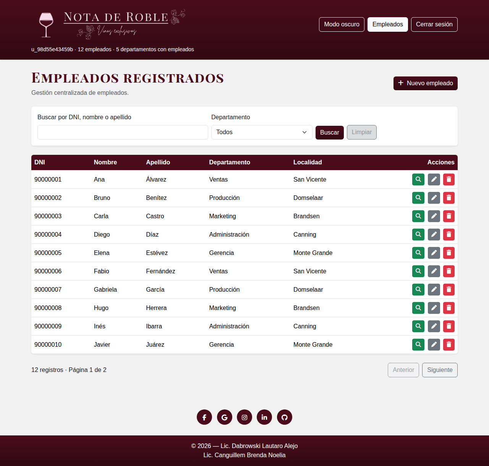
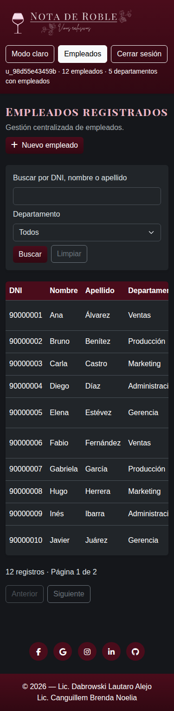
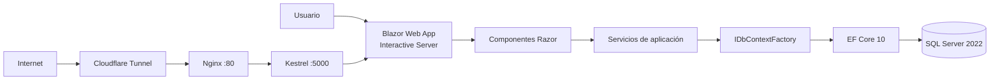

# InstitutoBlazor

Migración del CRUD original en **PHP/MySQL** a una aplicación **C# + Blazor Web App + Entity Framework Core + SQL Server**, preparada para ejecutarse y desplegarse en **Ubuntu Server**.

**Repositorio:** https://github.com/LautaroDabrowski/NotaDeRoble  
**Demo:** https://plugins-necessary-forms-tba.trycloudflare.com (URL temporal de Cloudflare Tunnel)





## Funcionalidades

- Registro e inicio de sesión con hash de contraseñas y sesión persistente tras F5 (8 horas).
- ABM de empleados con departamento y localidad relacionados.
- Validación de servidor con FluentValidation y expresiones regulares (DNI, teléfono, email).
- Mensajes de error junto a cada campo y resumen de validación.
- Búsqueda por DNI, nombre o apellido; filtro por departamento; paginación calculada en SQL Server.
- Índices únicos en DNI, email y nombre de usuario.
- Modo claro/oscuro persistente, diseño responsive, navegación por teclado y skip link.
- Health check `/health` que verifica conexión y esquema.
- Pruebas de persistencia en SQLite y SQL Server, más prueba E2E con Playwright.
- CI/CD con GitHub Actions y despliegue en Ubuntu Server con systemd, Nginx y Docker.

## Stack

| Capa | Tecnología |
|---|---|
| Aplicación | .NET 10, Blazor Web App (Interactive Server), Razor Components |
| Datos | Entity Framework Core 10, SQL Server 2022 |
| Validación | FluentValidation 12, DataAnnotations, expresiones regulares |
| Pruebas | xUnit, SQLite, SQL Server, Playwright |
| Infraestructura | Ubuntu Server 26.04 LTS, Nginx, systemd, Docker, GitHub Actions |

## Arquitectura

```text
Página Razor → Servicio → DbContext → SQL Server
```



```text
InstitutoBlazor/
├── Components/
│   ├── Layout/MainLayout.razor
│   ├── Pages/
│   │   ├── Login.razor / Register.razor
│   │   ├── Empleados.razor / EmpleadoNuevo.razor
│   │   ├── EmpleadoEditar.razor / EmpleadoVer.razor
│   │   └── Index.razor / Error.razor
│   └── Shared/
│       ├── EmployeeForm.razor / ServerValidation.razor
│       ├── Paginacion.razor / ThemeToggle.razor
│       ├── Header.razor / Footer.razor
│       ├── ConfirmDialog.razor / AlertMessage.razor
│       └── CopyLink.razor / DetailItem.razor / RedirectToLogin.razor
├── Data/
│   ├── AppDbContext.cs / AppDbContextDesignFactory.cs
│   ├── DemoData.cs / DatabaseHealthCheck.cs
│   └── Migrations/
├── Models/
├── Services/
├── Validators/
├── wwwroot/ (css, js, imágenes)
├── tests/
│   ├── InstitutoBlazor.Tests/ (xUnit)
│   └── browser/ (Playwright)
├── deploy/ubuntu/ (systemd, Nginx, Docker, script de despliegue)
├── docs/
├── Database/01_InstitutoEmpresa.sql (referencia del esquema original)
└── .github/workflows/ci-deploy.yml
```

## Requisitos

- .NET SDK 10.0.
- SQL Server 2019+ (local, Docker o Podman).
- Node.js 20+ solo para la prueba E2E.
- Opcional: Docker/Podman para levantar SQL Server.

En Ubuntu solo se necesita el **runtime ASP.NET Core 10** para ejecutar la app publicada.

## Puesta en marcha local

### 1. Clonar y restaurar

```bash
git clone https://github.com/LautaroDabrowski/NotaDeRoble.git
cd InstitutoBlazor
dotnet tool restore
dotnet restore InstitutoBlazor.sln
```

### 2. Levantar SQL Server

Con Docker:

```bash
docker run -d --name instituto-sql \
  -e ACCEPT_EULA=Y -e MSSQL_PID=Express \
  -e MSSQL_SA_PASSWORD='ClaveLocal1!' \
  -p 127.0.0.1:1433:1433 \
  -v instituto-sql:/var/opt/mssql \
  mcr.microsoft.com/mssql/server:2022-latest
```

Con Podman, reemplazar `docker` por `podman`.

### 3. Configurar la cadena de conexión

```bash
dotnet user-secrets set "ConnectionStrings:DefaultConnection" \
  "Server=127.0.0.1,1433;Database=InstitutoBlazorDemo;User Id=sa;Password=ClaveLocal1!;Encrypt=True;TrustServerCertificate=True"
```

No hay contraseñas versionadas en `appsettings.json`.

### 4. Aplicar migraciones y ejecutar

```bash
dotnet ef database update
dotnet run
```

Abrir `http://localhost:5068`, entrar a `/registro` para crear el primer usuario y luego iniciar sesión.

La migración de demostración crea 5 departamentos, 5 localidades y 12 empleados con DNI `90000001` a `90000012`.

Alternativa: definir `Database__ApplyMigrations=true` para que la app aplique migraciones al arrancar. Usarlo solo sobre una base nueva o con historial de EF.

## Pruebas

```bash
# SQLite en memoria
dotnet test InstitutoBlazor.sln -c Release

# SQLite + SQL Server real
INSTITUTO_TEST_SQLSERVER="Server=127.0.0.1,1433;Database=master;User Id=sa;Password=ClaveLocal1!;TrustServerCertificate=True" \
  dotnet test InstitutoBlazor.sln -c Release

# E2E (con la app y SQL Server levantados)
cd tests/browser
npm ci
npx playwright install chromium
npm test
```

La prueba E2E cubre registro, sesión tras F5, validaciones, CRUD, búsqueda, paginación, modo oscuro a 375 px y cierre de sesión.

## Configuración

| Clave | Uso |
|---|---|
| `ConnectionStrings:DefaultConnection` | Cadena de SQL Server. Obligatoria. |
| `Database:ApplyMigrations` | Aplica migraciones al arrancar (`false` por defecto). |
| `DataProtection:KeysPath` | Ruta persistente de claves de sesión (producción). |
| `AllowedHosts` | Hosts permitidos; en producción incluir dominio/IP. |

En producción se usan variables de entorno (`ConnectionStrings__DefaultConnection`, `Database__ApplyMigrations`, etc.) definidas en `/etc/institutoblazor/institutoblazor.env`.

## Despliegue

La guía completa está en [`docs/DESPLIEGUE.md`](docs/DESPLIEGUE.md):

- Ubuntu Server 26.04 LTS con .NET 10, Nginx, systemd y SQL Server en Docker.
- Runner self-hosted de GitHub Actions.
- Publicación automática desde `main` con verificación de `/health`.
- Firewall, URL pública, TLS opcional con Certbot y rollback.

Documentación adicional:

- [`docs/VM-LOCAL.md`](docs/VM-LOCAL.md): creación de la VM Ubuntu Server con QEMU/KVM y URL pública.
- [`docs/BASE-DE-DATOS.md`](docs/BASE-DE-DATOS.md): modelo, migraciones, usuarios, backups y restauración.
- [`docs/GIT-Y-GITHUB.md`](docs/GIT-Y-GITHUB.md): ramas, issues, tablero, PRs y evidencias.
- [`docs/PRESENTACION.md`](docs/PRESENTACION.md): guion de demo, estado de entrega y preguntas frecuentes.
- [`docs/GUIA-DE-ESTUDIO-REQUISITOS.md`](docs/GUIA-DE-ESTUDIO-REQUISITOS.md): mapa de cada requisito de la exposición con archivos y líneas.
- [`docs/GUIA-DE-ESTUDIO-REQUISITOS.pdf`](docs/GUIA-DE-ESTUDIO-REQUISITOS.pdf): la misma guía en PDF para imprimir o estudiar sin conexión.
- [`CHANGELOG.md`](CHANGELOG.md): cambios por versión.

## CI/CD

`.github/workflows/ci-deploy.yml`:

1. Compila en Release con warnings como errores.
2. Ejecuta pruebas con SQLite.
3. Levanta SQL Server temporal y repite las pruebas contra SQL Server.
4. Verifica que el modelo no tenga cambios sin migración.
5. Publica la app y un script SQL idempotente.
6. En `main`, con `DEPLOY_ENABLED=true`, despliega con el runner self-hosted y espera `/health`.

## Seguridad

- Contraseñas con `PasswordHasher<Usuario>`; nunca en texto plano.
- Cadena de conexión fuera del repositorio (user secrets o variables de entorno).
- Login de base de datos con permisos mínimos después del primer despliegue.
- Kestrel y SQL Server escuchan solo en loopback; Nginx es la única entrada.
- Firewall con puertos 22/80/443.
- Claves de Data Protection persistentes para conservar sesiones entre reinicios.

## Migración desde PHP

| Archivo PHP original | Reemplazo en Blazor |
|---|---|
| `login.php`, `validar-email.php` | `Login.razor` + `UsuarioService` |
| `registro.php`, `guardar-usuario.php` | `Register.razor` + `UsuarioService` |
| `index.php` | `Empleados.razor` |
| `registro-empleado.php`, `guardar.php` | `EmpleadoNuevo.razor` + `EmployeeForm.razor` |
| `editar.php` | `EmpleadoEditar.razor` |
| `ver.php` | `EmpleadoVer.razor` |
| `eliminar.php` | `EmpleadoService` + `ConfirmDialog.razor` |
| `includes/header.php`, `footer.php` | `Header.razor`, `Footer.razor` |
| `conexion.php` | `AppDbContext` + EF Core |

Se eliminaron `$_POST`, `$_GET`, `$_SESSION`, `include()` y las consultas concatenadas. EF Core parametriza las consultas y centraliza el acceso a datos en servicios.

## Solución de problemas

| Problema | Solución |
|---|---|
| Error de conexión a SQL Server | Verificar contenedor, puerto 1433 y cadena en user secrets. |
| `dotnet ef` no encontrado | `dotnet tool restore`. |
| Sesión se pierde al reiniciar | Configurar `DataProtection:KeysPath` persistente. |
| Pruebas E2E fallan por navegador | `npx playwright install chromium`. |
| `/health` devuelve Unhealthy | Revisar logs del servicio y la base; el esquema debe existir. |
